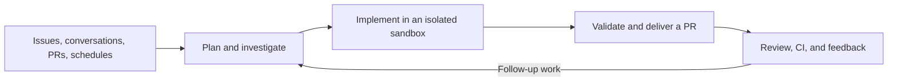

<div align="center">
  <picture>
    <source media="(prefers-color-scheme: dark)" srcset="assets/dark.svg">
    <source media="(prefers-color-scheme: light)" srcset="assets/light.svg">
    
  </picture>
</div>

<div align="center">
  <h3>An open-source software factory built on Deep Agents by LangChain.</h3>
</div>

<div align="center">
  <a href="https://opensource.org/licenses/MIT" target="_blank"></a>
  <a href="https://github.com/langchain-ai/deepagents" target="_blank"></a>
  <a href="https://github.com/langchain-ai/langgraph" target="_blank"></a>
  <a href="https://x.com/langchain" target="_blank"></a>
</div>

<br>

Alephat turns engineering work into a repeatable system: investigate a codebase, implement changes, validate them, and deliver a pull request.
It also reviews pull requests, learns repository-specific review preferences, monitors CI, and responds to feedback.
Built on LangGraph and Deep Agents by LangChain, it is open source and deployable in your infrastructure.

> [!NOTE]
> Alephat is under active development.
> APIs, setup, and product surfaces may continue to evolve.

---

Alephat is a fork of [Open SWE](https://github.com/langchain-ai/open-swe) with a standalone Kubernetes platform.
See [the platform guide](docs/PLATFORM.md) and the GKE deployment guide below.
The current upstream runtime requires Python 3.14 or newer; the platform images and dependency lockfile use that runtime.

## What Alephat does



- **Build:** Investigate repositories, edit code, run focused validation, and open or update pull requests.
- **Parallelize:** Use subagents for research and independent work.
- **Review:** Run on-demand or opt-in automatic reviews, publish findings to GitHub, and learn from historical feedback.
- **Investigate:** Use read-only PR chat to understand a change without implementing changes.
- **Operate:** Schedule recurring tasks and monitor opted-in PRs with `/baby-sit`, diagnosing failures and rerunning only evidence-backed flaky jobs.
- **Customize:** Choose models, reasoning effort, instructions, skills, integrations, and sandbox providers.

Start and continue work from the **dashboard**, **GitHub issues and PR conversations**, or **Slack**.
In [Linear](docs/INSTALLATION.md#linear), mention or delegate an issue to the app to open an agent session.
Cloud coding follow-ups reuse the thread’s context and sandbox; independent threads can run in parallel.

## How it works

[Deep Agents](https://github.com/langchain-ai/deepagents) supplies planning, filesystem, shell, skills, and subagent primitives.
[LangGraph](https://github.com/langchain-ai/langgraph) provides durable execution and thread state.
Alephat adds engineering tools, integrations, authorization, and user interfaces.
The graph entrypoints are declared in [`langgraph.json`](langgraph.json), with an overview in [`AGENTS.md`](AGENTS.md).

Cloud coding runs in persistent, per-thread Linux sandboxes with tooling supplied by workspace scripts or snapshots.
An unreachable coding sandbox is not silently replaced.
[LangSmith](https://smith.langchain.com/) is the default sandbox and tracing provider; [other providers and local execution](docs/CUSTOMIZATION.md#1-sandbox) are configurable.
PR chat does not need a sandbox.

## Control and safety

- **GitHub access:** Coding sandboxes normally receive installation-wide GitHub App access; selected workflows use narrower repository scopes.
  Workspace repository bindings control routing and preloaded checkouts, not a separate credential boundary.
  See [GitHub access](docs/reference/workspaces.md#github-access-and-the-sandbox-image).
- **Integrations:** MCP connections layer instance-wide, workspace-specific, and personal tools.
  Configure their scope and credentials in the [customization guide](docs/CUSTOMIZATION.md#workspace-mcp-servers).
- **Approvals:** Workflow-file approval prompts guard detected Git pushes, not every possible shell or API write.
  Reviewers are instructed not to commit or push; PR chat excludes mutation tools.

Sandboxes have powerful tools and may have network access.
Use least-privilege credentials, restrict repositories and integrations, and tailor approval policies to your deployment.
Local execution does not provide cloud sandbox isolation.

## Documentation

- [Platform guide](docs/PLATFORM.md) — Multi-service Kubernetes platform architecture and local Compose workflow
- [Installation guide](docs/INSTALLATION.md) — Deploy for a team: LangGraph Platform or Docker, the GitHub and Slack apps, model providers, environment variables, and the optional Linear trigger
- [Development guide](docs/DEVELOPMENT.md) — Run it on your machine, with hot reload for the dashboard and an ngrok tunnel for webhooks
- [Customization guide](docs/CUSTOMIZATION.md) — Models, sandboxes, tools, skills, prompts, triggers, and middleware
- [Workspaces reference](docs/reference/workspaces.md) — Routing, settings, images, and access
- [Human review in Slack](docs/reference/human-review.md) — Review requests in a repository's Slack channel, merged once reviewers approve
- [Expedited Slack review](docs/reference/expedited-slack-review.md) — Human approval for small pull requests
- [Backend API documentation](docs/DEVELOPMENT.md#backend-api-documentation) — Live API docs and the generated [OpenAPI schema](swagger.json)
- [Original announcement](https://blog.langchain.com/open-swe-an-open-source-framework-for-internal-coding-agents/) — Background on the internal coding-agent framework
- [Security policy](SECURITY.md) — Report security concerns privately

## License

Alephat is licensed under the [MIT License](LICENSE).

That license covers this repository's own code only.
It does not cover anything under [`vendor/`](vendor/README.md), which is not licensed by this repository at all.

## Standalone Kubernetes & GKE deployment (`deploy/helm/alephat`)

This fork runs Alephat's API, webhook receiver (with outbound Slack Socket Mode), dashboard, Temporal DeepAgents worker (with rich Slack `@json-render/chat` sidecar), PostgreSQL, self-hosted Temporal Service (`temporalio/server:1.32.2` with mTLS + `temporalio/ui`), LiteLLM gateway, KEDA autoscaler, and isolated code sandboxes on Kubernetes.
It does **not** require a LangSmith deployment, a commercial sandbox account, or any Alephat license key.

### Unified multi-namespace Helm chart (`deploy/helm/alephat`)

Once any Kubernetes `1.28+` cluster is ready, **one Helm chart** (`deploy/helm/alephat`) installs all CRDs, operators, datastores, ingress, and Alephat services in a single release — placing Alephat's own services in `alephat` and isolating every dependency in its own dedicated namespace:

| Namespace (`values.yaml`) | Components |
|---|---|
| `alephat` (`namespaces.alephat`) | `alephat-api`, `alephat-webhook`, `alephat-harness` (+ `slack-renderer` sidecar), `alephat-ui`, `alephat-migrate` Job, `alephat-config`, KEDA `ScaledObject` & `TriggerAuthentication`, `IngressRoute/alephat` |
| `postgresql` (`namespaces.postgresql`) | `alephat-postgresql` StatefulSet (`20Gi` PVC hosting `alephat`, `temporal`, and `temporal_visibility`) |
| `temporal` (`namespaces.temporal`) | `temporal` Server `1.32.2` (mTLS `requireClientAuth: true`), `temporal-namespace` Job, `temporal-ui`, `IngressRoute/temporal-ui`, `IngressRoute/temporal-grpc` + `TLSOption` + `ServersTransport` |
| `litellm` (`namespaces.litellm`) | `litellm` Gateway `1.106.6` (Gemini, Anthropic Claude, and OpenAI coding models) + `litellm-postgresql` (`20Gi` PVC) |
| `alephat-sandboxes` (`namespaces.sandboxes`) | `SandboxTemplate/python-runtime-template` (`kata-qemu` or `gvisor`), RBAC, `NetworkPolicy` |
| `agent-sandbox-system` (`namespaces.agentSandboxSystem`) | `agent-sandbox-controller` (`v1.0.9`) |
| `kata-system` (`namespaces.kata`) | `kata-deploy` DaemonSet (`4.3.1`) + `RuntimeClass/kata-qemu` (when `sandboxRuntime.type=kata`) |
| `keda` (`namespaces.keda`) | `keda-operator`, `keda-operator-metrics-apiserver`, `keda-admission-webhooks` (`2.21.0`) |
| `external-secrets` (`namespaces.externalSecrets`) | External Secrets Operator (`2.14.0`) + `ClusterSecretStore/gcp-secret-manager` (when `externalSecrets.enabled=true`) |
| `traefik` (`namespaces.traefik`) | Traefik (`v3.7.17`) `LoadBalancer` (`:80`, `:443`, `:7233`) + Let's Encrypt `tlsChallenge` PVC |

```bash
# Install on any ready Kubernetes cluster (auto-generates cross-namespace mTLS & DB secrets when externalSecrets.enabled=false)
helm upgrade --install alephat ./deploy/helm/alephat \
  --namespace alephat \
  --create-namespace \
  --set externalSecrets.enabled=false \
  --set secrets.providerKeys.geminiApiKey="$GEMINI_API_KEY" \
  --set secrets.providerKeys.anthropicApiKey="$ANTHROPIC_API_KEY" \
  --set secrets.providerKeys.openaiApiKey="$OPENAI_API_KEY" \
  --set alephat.platformImage="$PLATFORM_IMAGE" \
  --set alephat.uiImage="$UI_IMAGE" \
  --set alephat.slackRendererImage="$SLACK_RENDERER_IMAGE" \
  --set agentSandbox.sandboxImage="$SANDBOX_IMAGE" \
  --set ingress.host="alephat.example.com" \
  --set ingress.temporalUiHost="temporal.example.com" \
  --set ingress.temporalGrpcHost="temporal-grpc.example.com" \
  --wait --timeout 15m
```

### Automated one-command GKE deployment (`./deploy/gke-deploy.sh`)

`./deploy/gke-deploy.sh` auto-loads credentials from `deploy/.env` if present, provisions the GKE cluster (choosing either **Kata** with Ubuntu + nested virtualization or **gVisor** with Container-Optimized OS + a gVisor sandbox node pool), configures Workload Identity IAM and Google Cloud Secret Manager secrets (including Temporal mTLS certificates), builds and pushes the four images in parallel (`alephat-platform`, `alephat-ui`, `alephat-slack-renderer`, and `alephat-sandbox`), and installs `deploy/helm/alephat`:

```bash
# Deploy with Kata Containers (default) and Gemini, Anthropic, and OpenAI coding models in LiteLLM
./deploy/gke-deploy.sh \
  --project your-gcp-project-id \
  --region us-central1 \
  --sandbox-runtime kata \
  --node-size n2-standard-4 \
  --with-traefik

# Or deploy with gVisor instead of Kata
./deploy/gke-deploy.sh \
  --project your-gcp-project-id \
  --region us-central1 \
  --sandbox-runtime gvisor \
  --node-size e2-standard-4 \
  --with-traefik

# Preview rendered Helm values and validate chart templates without applying
./deploy/gke-deploy.sh --dry-run --with-traefik

# Tear down the cluster, static IP, unattached PVC disks, and optional Artifact Registry / IAM / Secret Manager resources
./deploy/gke-teardown.sh \
  --project your-gcp-project-id \
  --region us-central1 \
  --delete-images \
  --delete-iam \
  --delete-secrets
```

### Step-by-step manual GKE deployment

1. **Prerequisites & APIs** — Install `gcloud` (with `gke-gcloud-auth-plugin`), `kubectl`, `helm` (`v3.14+`), `jq`, and `openssl`, then enable required GCP APIs:
   ```bash
   export PROJECT_ID="your-gcp-project-id"
   export REGION="us-central1"
   export ZONE="us-central1-a"
   export CLUSTER_NAME="alephat"
   export AR_REPOSITORY="alephat"
   export PLATFORM_IMAGE="${REGION}-docker.pkg.dev/${PROJECT_ID}/${AR_REPOSITORY}/alephat-platform:latest"
   export UI_IMAGE="${REGION}-docker.pkg.dev/${PROJECT_ID}/${AR_REPOSITORY}/alephat-ui:latest"
   export SLACK_RENDERER_IMAGE="${REGION}-docker.pkg.dev/${PROJECT_ID}/${AR_REPOSITORY}/alephat-slack-renderer:latest"
   export SANDBOX_IMAGE="${REGION}-docker.pkg.dev/${PROJECT_ID}/${AR_REPOSITORY}/alephat-sandbox:latest"

   gcloud config set project "$PROJECT_ID"
   gcloud services enable \
     aiplatform.googleapis.com artifactregistry.googleapis.com cloudbuild.googleapis.com \
     compute.googleapis.com container.googleapis.com dns.googleapis.com \
     iamcredentials.googleapis.com secretmanager.googleapis.com
   ```

2. **Create the GKE cluster** — Use `UBUNTU_CONTAINERD` with `--enable-nested-virtualization` on Intel `N2`/`C2`/`C3` nodes for Kata (do not use `E2`, `N2D`, or Arm for Kata):
   ```bash
   gcloud container clusters create "$CLUSTER_NAME" \
     --zone "$ZONE" \
     --num-nodes 3 \
     --enable-autoscaling --min-nodes 2 --max-nodes 6 \
     --machine-type n2-standard-4 \
     --image-type UBUNTU_CONTAINERD \
     --enable-dataplane-v2 \
     --enable-ip-alias \
     --enable-nested-virtualization \
     --workload-pool="${PROJECT_ID}.svc.id.goog" \
     --workload-metadata=GKE_METADATA

   gcloud container clusters get-credentials "$CLUSTER_NAME" --zone "$ZONE"
   ```

3. **Build and push images** — Create the Artifact Registry repo and build all four container images:
   ```bash
   gcloud artifacts repositories describe "$AR_REPOSITORY" --location "$REGION" >/dev/null 2>&1 || \
     gcloud artifacts repositories create "$AR_REPOSITORY" --repository-format docker --location "$REGION"

   gcloud builds submit . --config cloudbuild.platform.yaml --substitutions="_PLATFORM_IMAGE=${PLATFORM_IMAGE}" &
   gcloud builds submit . --config cloudbuild.ui.yaml --substitutions="_UI_IMAGE=${UI_IMAGE}" &
   gcloud builds submit . --config cloudbuild.slack-renderer.yaml --substitutions="_SLACK_RENDERER_IMAGE=${SLACK_RENDERER_IMAGE}" &
   gcloud builds submit . --config cloudbuild.sandbox.yaml --substitutions="_SANDBOX_IMAGE=${SANDBOX_IMAGE}" &
   wait
   ```

4. **Configure GitHub App & install the unified Helm chart** — Reserve a static LoadBalancer IP (using `sslip.io` or Cloud DNS), configure your GitHub App Callback URL (`https://<host>/dashboard/api/auth/callback`) and Webhook URL (`https://<host>/hooks/github`), and install `deploy/helm/alephat`:
   ```bash
   gcloud compute addresses create alephat-traefik --region "$REGION" --network-tier PREMIUM
   export TRAEFIK_IP="$(gcloud compute addresses describe alephat-traefik --region "$REGION" --format='value(address)')"
   export BASE_SSLIP="${TRAEFIK_IP//./-}.sslip.io"

   helm upgrade --install alephat ./deploy/helm/alephat \
     --namespace alephat \
     --create-namespace \
     --set externalSecrets.enabled=false \
     --set alephat.platformImage="$PLATFORM_IMAGE" \
     --set alephat.uiImage="$UI_IMAGE" \
     --set alephat.slackRendererImage="$SLACK_RENDERER_IMAGE" \
     --set agentSandbox.sandboxImage="$SANDBOX_IMAGE" \
     --set secrets.providerKeys.geminiApiKey="$GEMINI_API_KEY" \
     --set secrets.providerKeys.anthropicApiKey="$ANTHROPIC_API_KEY" \
     --set secrets.providerKeys.openaiApiKey="$OPENAI_API_KEY" \
     --set secrets.githubApp.appId="$GITHUB_APP_ID" \
     --set secrets.githubApp.clientId="$GITHUB_APP_CLIENT_ID" \
     --set secrets.githubApp.clientSecret="$GITHUB_APP_CLIENT_SECRET" \
     --set secrets.githubApp.installationId="$GITHUB_APP_INSTALLATION_ID" \
     --set-file secrets.githubApp.privateKey="$GITHUB_APP_PRIVATE_KEY_FILE" \
     --set secrets.githubApp.allowedUsers="$ALLOWED_GITHUB_USERS" \
     --set traefik.loadBalancerIP="$TRAEFIK_IP" \
     --set traefik.acme.email="$ACME_EMAIL" \
     --set ingress.host="alephat.${BASE_SSLIP}" \
     --set ingress.temporalUiHost="temporal.${BASE_SSLIP}" \
     --set ingress.temporalGrpcHost="temporal-grpc.${BASE_SSLIP}" \
     --wait --timeout 15m
   ```

5. **Verify multi-namespace isolation, Kata sandboxes, and KEDA scaling**:
   ```bash
   kubectl get pods -A
   kubectl -n alephat get scaledobject,hpa
   kubectl -n alephat-sandboxes get sandboxtemplate,sandbox,pod -o wide
   ```

6. **Production hardening & teardown** — Back up the `alephat`, `temporal`, and `temporal_visibility` databases in `postgresql/alephat-postgresql-0` before destructive maintenance; use Cloud SQL, multi-replica Temporal services, and cert-manager for regional HA. When finished, tear down the cluster, static IP, and unattached PVCs with:
   ```bash
   ./deploy/gke-teardown.sh --project "$PROJECT_ID" --region "$REGION" --zone "$ZONE" --cluster-name "$CLUSTER_NAME"
   ```

References: [GKE Agent Sandbox](https://docs.cloud.google.com/kubernetes-engine/docs/concepts/machine-learning/agent-sandbox), [Agent Sandbox releases](https://github.com/kubernetes-sigs/agent-sandbox/releases), [Kata installation](https://kata-containers.github.io/kata-containers/installation/), [KEDA Temporal scaler](https://keda.sh/docs/2.21/scalers/temporal/), [Traefik Kubernetes installation](https://doc.traefik.io/traefik/getting-started/kubernetes/), [GKE static LoadBalancer addresses](https://docs.cloud.google.com/kubernetes-engine/docs/concepts/service-load-balancer-parameters), [Cloud DNS records](https://docs.cloud.google.com/dns/docs/records), and [GitHub App OAuth callbacks](https://docs.github.com/en/apps/creating-github-apps/registering-a-github-app/about-the-user-authorization-callback-url).
