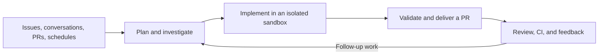

<div align="center">
  <a href="https://github.com/moule3053/alephat">
    <picture>
      <source media="(prefers-color-scheme: dark)" srcset="assets/dark.svg">
      <source media="(prefers-color-scheme: light)" srcset="assets/light.svg">
      
    </picture>
  </a>
</div>

<div align="center">
  <h3>An open-source software factory built on Deep Agents by LangChain.</h3>
</div>

<div align="center">
  <a href="https://opensource.org/licenses/MIT" target="_blank"></a>
  <a href="https://github.com/moule3053/alephat" target="_blank"></a>
  <a href="https://github.com/langchain-ai/deepagents" target="_blank"></a>
  <a href="https://github.com/langchain-ai/langgraph" target="_blank"></a>
  <a href="https://x.com/langchain" target="_blank"></a>
</div>

<br>

Alephat turns engineering work into a repeatable system: investigate a codebase, implement changes, validate them, and deliver a pull request.
It also reviews pull requests, learns repository-specific review preferences, monitors CI, and responds to feedback.
Built on Open SWE and Deep Agents by LangChain, it is open source and deployable in your infrastructure.

> [!NOTE]
> Alephat is under active development.
> APIs, setup, and product surfaces may continue to evolve.

---

Alephat is a fork of [Open SWE](https://github.com/langchain-ai/open-swe) with a standalone Kubernetes platform.
See [the platform guide](docs/PLATFORM.md) and the GKE deployment guide below.
The current upstream runtime requires Python 3.14 or newer; the platform images and dependency lockfile use that runtime.

## What Alephat does



- **Build:** Investigate repositories, edit code, run focused validation, and open or update pull requests.
- **Parallelize:** Use subagents for research and independent work.
- **Review:** Run on-demand or opt-in automatic reviews, publish findings to GitHub, and learn from historical feedback.
- **Investigate:** Use read-only PR chat to understand a change without implementing changes.
- **Operate:** Schedule recurring tasks and monitor opted-in PRs with `/baby-sit`, diagnosing failures and rerunning only evidence-backed flaky jobs.
- **Customize:** Choose models, reasoning effort, instructions, skills, integrations, and sandbox providers.

Start and continue work from the **dashboard**, **GitHub issues and PR conversations**, or **Slack**.
In [Linear](docs/INSTALLATION.md#linear), mention or delegate an issue to the app to open an agent session.
Cloud coding follow-ups reuse the thread’s context and sandbox; independent threads can run in parallel.

## How it works

[Deep Agents](https://github.com/langchain-ai/deepagents) supplies planning, filesystem, shell, skills, and subagent primitives.
[LangGraph](https://github.com/langchain-ai/langgraph) provides durable execution and thread state.
Open SWE adds engineering tools, integrations, authorization, and user interfaces.
The graph entrypoints are declared in [`langgraph.json`](langgraph.json), with an [architecture inventory](AGENTS.md#architecture).

Cloud coding runs in persistent, per-thread Linux sandboxes with tooling supplied by workspace scripts or snapshots.
An unreachable coding sandbox is not silently replaced.
[LangSmith](https://smith.langchain.com/) is the default sandbox and tracing provider; [other providers and local execution](docs/CUSTOMIZATION.md#1-sandbox) are configurable.
PR chat does not need a sandbox.

## Control and safety

- **GitHub access:** Coding sandboxes normally receive installation-wide GitHub App access; selected workflows use narrower repository scopes.
  Workspace repository bindings control routing and preloaded checkouts, not a separate credential boundary.
  See [GitHub access](docs/reference/workspaces.md#github-access-and-the-sandbox-image).
- **Integrations:** MCP connections layer instance-wide, workspace-specific, and personal tools.
  Configure their scope and credentials in the [customization guide](docs/CUSTOMIZATION.md#workspace-mcp-servers).
- **Approvals:** Workflow-file approval prompts guard detected Git pushes, not every possible shell or API write.
  Reviewers are instructed not to commit or push; PR chat excludes mutation tools.

Sandboxes have powerful tools and may have network access.
Use least-privilege credentials, restrict repositories and integrations, and tailor approval policies to your deployment.
Local execution does not provide cloud sandbox isolation.

## Documentation

- [Platform guide](docs/PLATFORM.md) — Multi-service Kubernetes platform architecture and local Compose workflow
- [Installation guide](docs/INSTALLATION.md) — Deploy for a team: LangGraph Platform or Docker, the GitHub and Slack apps, model providers, environment variables, and the optional Linear trigger
- [Development guide](docs/DEVELOPMENT.md) — Run it on your machine, with hot reload for the dashboard and an ngrok tunnel for webhooks
- [Customization guide](docs/CUSTOMIZATION.md) — Models, sandboxes, tools, skills, prompts, triggers, and middleware
- [Workspaces reference](docs/reference/workspaces.md) — Routing, settings, images, and access
- [Human review in Slack](docs/reference/human-review.md) — Review requests in a repository's Slack channel, merged once reviewers approve
- [Expedited Slack review](docs/reference/expedited-slack-review.md) — Human approval for small pull requests
- [Backend API documentation](docs/DEVELOPMENT.md#backend-api-documentation) — Live API docs and the generated [OpenAPI schema](swagger.json)
- [Original announcement](https://blog.langchain.com/open-swe-an-open-source-framework-for-internal-coding-agents/) — Background on the internal coding-agent framework
- [Security policy](SECURITY.md) — Report security concerns privately

## License

Alephat is licensed under the [MIT License](LICENSE).

That license covers this repository's own code only.
It does not cover anything under [`vendor/`](vendor/README.md), which is not licensed by this repository at all.

## Standalone GKE deployment: Kata or gVisor, Agent Sandbox, LiteLLM, and KEDA

This fork can run Alephat's API, webhook receiver, dashboard, worker harness, PostgreSQL, NATS JetStream, LiteLLM gateway, and code sandboxes on Kubernetes.
It does **not** require a LangSmith deployment, a commercial sandbox account, or any Alephat license key.
The checked-in configuration uses the open-source editions of Agent Sandbox (`v1.0.9`), Kata Containers (`4.3.1`) or gVisor, KEDA (`2.21.0`), External Secrets Operator (`2.14.0`) with Google Cloud Secret Manager, NATS (`2.12`), PostgreSQL (`17`), and LiteLLM (`1.106.6`).

### Automated one-command deployment (`./deploy/gke-deploy.sh`)

`./deploy/gke-deploy.sh` provisions the GKE cluster (choosing either **Kata** with Ubuntu + nested virtualization or **gVisor** with Container-Optimized OS + a gVisor sandbox node pool), installs Agent Sandbox and KEDA, deploys LiteLLM with your chosen `--models`, builds and pushes the images, and deploys the Alephat platform and harness:

```bash
# Deploy with Kata Containers (default) and Gemini 4 Argon + OpenAI + Anthropic in LiteLLM
./deploy/gke-deploy.sh \
  --project your-gcp-project-id \
  --region us-central1 \
  --sandbox-runtime kata \
  --node-size n2-standard-4 \
  --models "google:gemini-4-argon,google_genai:gemini-4-argon,openai:gpt-4o-mini,anthropic:claude-3-5-sonnet"

# Or deploy with gVisor instead of Kata
./deploy/gke-deploy.sh \
  --project your-gcp-project-id \
  --region us-central1 \
  --sandbox-runtime gvisor \
  --node-size e2-standard-4 \
  --models "google:gemini-4-argon,openai:gpt-4o-mini"

# Preview rendered SandboxTemplate and LiteLLM config without applying
./deploy/gke-deploy.sh --dry-run --sandbox-runtime gvisor --region europe-west1

# Tear down the cluster, static IP, and optional Artifact Registry / IAM resources
./deploy/gke-teardown.sh --project your-gcp-project-id --region us-central1 --delete-images --delete-iam
```

You still pay for GKE and model usage, and you must supply normal authentication credentials: a GitHub App plus an API key for each model provider you enable.
Those are service credentials, not license keys.
LiteLLM enterprise-only metering is disabled.

The following path creates a GKE Standard cluster with Intel N2 Ubuntu nodes, nested virtualization, Kata's `kata-qemu` runtime, the open-source Agent Sandbox controller, and KEDA scaling of harness workers from NATS JetStream lag.

> [!IMPORTANT]
> Google also offers a managed GKE Agent Sandbox add-on.
> On Standard clusters its admission policy currently requires gVisor.
> This guide uses the open-source Agent Sandbox controller because the requested runtime is Kata.
> See Google's [managed Agent Sandbox guide](https://docs.cloud.google.com/kubernetes-engine/docs/how-to/how-install-agent-sandbox) if you prefer gVisor instead.
> Kata on GKE is user-managed and is not covered by Google Cloud support.

### 1. Install the command-line prerequisites

Install and authenticate:

- [Google Cloud CLI](https://cloud.google.com/sdk/docs/install), including `gke-gcloud-auth-plugin`
- `kubectl`, [Helm 3](https://helm.sh/docs/intro/install/), and [Kustomize](https://kubectl.docs.kubernetes.io/installation/kustomize/)
- `git`, `curl`, and `openssl`

Use a Google Cloud project with billing enabled, then clone this fork and set deployment values:

```bash
export PROJECT_ID="your-gcp-project-id"
export REGION="us-central1"
export ZONE="us-central1-a"
export CLUSTER_NAME="alephat"
export AR_REPOSITORY="alephat"
export PLATFORM_NAMESPACE="alephat"
export SANDBOX_NAMESPACE="alephat-sandboxes"
export PLATFORM_IMAGE="${REGION}-docker.pkg.dev/${PROJECT_ID}/${AR_REPOSITORY}/alephat-platform:latest"
export UI_IMAGE="${REGION}-docker.pkg.dev/${PROJECT_ID}/${AR_REPOSITORY}/alephat-ui:latest"
export SANDBOX_IMAGE="${REGION}-docker.pkg.dev/${PROJECT_ID}/${AR_REPOSITORY}/alephat-sandbox:latest"

# Required when publishing the dashboard with Traefik in step 9.
export DNS_DOMAIN="example.com"
export DNS_ZONE="example-com"
export ALEPHAT_HOST="alephat.example.com"
export ALEPHAT_ORIGIN="https://${ALEPHAT_HOST}"
export ACME_EMAIL="admin@example.com"
export TRAEFIK_IP_NAME="alephat-traefik"

gcloud config set project "$PROJECT_ID"
gcloud services enable \
  aiplatform.googleapis.com \
  artifactregistry.googleapis.com \
  cloudbuild.googleapis.com \
  compute.googleapis.com \
  container.googleapis.com \
  dns.googleapis.com \
  iamcredentials.googleapis.com
```

These instructions use Vertex AI through Workload Identity for the default Gemini alias.
A separate Google AI Studio API-key alias is also configured for deployments that prefer that route.

### 2. Create the GKE cluster and install Kata Containers

Agent Sandbox maintains an [official Kata-on-GKE example](https://github.com/kubernetes-sigs/agent-sandbox/tree/main/examples/kata-gke-sandbox).
Its setup script creates a zonal Standard cluster with Dataplane V2, IP aliases, nested virtualization, Ubuntu containerd, and an Intel N2 machine type; it then installs Kata and registers `RuntimeClass/kata-qemu`.

```bash
git clone --depth 1 https://github.com/kubernetes-sigs/agent-sandbox.git /tmp/agent-sandbox

(
  cd /tmp/agent-sandbox/examples/kata-gke-sandbox
  ./setup.sh \
    --cluster-name "$CLUSTER_NAME" \
    --zone "$ZONE" \
    --num-nodes 2 \
    --machine-type n2-standard-4 \
    --image-type UBUNTU_CONTAINERD
)
```

If you created the cluster separately with `--enable-nested-virtualization`, rerun the same script with `--reuse-cluster`.
Do not use E2, N2D, Arm, or Container-Optimized OS nodes for this Kata path.
Choose a zone where N2 machines and nested virtualization are available.

Verify cluster access and Kata:

```bash
gcloud container clusters get-credentials "$CLUSTER_NAME" --zone "$ZONE"
kubectl get nodes -o wide
kubectl get runtimeclass kata-qemu
kubectl -n kube-system rollout status daemonset/kata-deploy --timeout=10m
```

Enable Workload Identity Federation and the GKE metadata server.
LiteLLM uses this identity to call Vertex AI without a long-lived Google service-account key:

```bash
gcloud container clusters update "$CLUSTER_NAME" \
  --zone "$ZONE" \
  --workload-pool="${PROJECT_ID}.svc.id.goog"

gcloud container node-pools update default-pool \
  --cluster "$CLUSTER_NAME" \
  --zone "$ZONE" \
  --workload-metadata=GKE_METADATA
```

The upstream example currently pins Kata `3.2.0`.
Review and pin a newer tested release deliberately before upgrading; changing the runtime on a live sandbox node pool should be treated as an infrastructure upgrade.

### 3. Install Agent Sandbox and the Kata sandbox template

This fork calls the `v1beta1` Agent Sandbox APIs.
The tested `v1.0.9` release serves `v1beta1` and includes the extensions controller used by `SandboxTemplate`:

```bash
export AGENT_SANDBOX_VERSION="v1.0.9"

kubectl apply -f \
  "https://github.com/kubernetes-sigs/agent-sandbox/releases/download/${AGENT_SANDBOX_VERSION}/sandbox-with-extensions.yaml"

kubectl wait --for=condition=Established crd/sandboxes.agents.x-k8s.io --timeout=2m
kubectl wait --for=condition=Established \
  crd/sandboxtemplates.extensions.agents.x-k8s.io --timeout=2m

kubectl get runtimeclass kata-qemu
```

The sandbox template is applied after its runtime image is built in steps 7–8.
It uses `runtimeClassName: kata-qemu`, the Agent Sandbox Python toolbox on port `8888`, a non-root user, no service-account token, dropped capabilities, and resource limits.
The Alephat runtime image adds Git, GitHub CLI, curl, and CA certificates to the pinned upstream toolbox image so workers can clone the selected repository and publish pull requests.
The harness creates a direct `Sandbox` from this template for every task; a warm pool is not required by this provider.

### 4. Install KEDA

KEDA scales the harness deployment from one to fifty workers based on the pending message count for the durable `harness-workers` consumer on the `TASKS` JetStream stream.
Keeping one worker running prevents queue-based scale-down from interrupting a task after its message has been claimed.
One harness Pod processes one task at a time.

```bash
helm repo add kedacore https://kedacore.github.io/charts
helm repo update
helm upgrade --install keda kedacore/keda \
  --namespace keda \
  --create-namespace \
  --version 2.21.0

kubectl -n keda rollout status deployment/keda-operator --timeout=5m
kubectl get crd scaledobjects.keda.sh
```

The NATS JetStream scaler is included in KEDA; no separate scaler installation is required.
The `ScaledObject` is applied after Alephat starts once, so the API has created the streams and the initial harness has created its durable consumer.

### 5. Deploy standalone LiteLLM with OpenAI, Anthropic, and Gemini routes

Create the platform namespace and LiteLLM secrets.
Omit a provider key only after removing its corresponding model entry from `deploy/k8s/litellm-values.yaml`.

```bash
kubectl create namespace "$PLATFORM_NAMESPACE" \
  --dry-run=client -o yaml | kubectl apply -f -

read -rsp "OpenAI API key: " OPENAI_API_KEY; echo
read -rsp "Anthropic API key: " ANTHROPIC_API_KEY; echo
read -rsp "Gemini API key: " GEMINI_API_KEY; echo

export LITELLM_MASTER_KEY="sk-$(openssl rand -hex 24)"
export LITELLM_DB_PASSWORD="$(openssl rand -hex 24)"

kubectl -n "$PLATFORM_NAMESPACE" create secret generic litellm-secrets \
  --from-literal=masterkey="$LITELLM_MASTER_KEY"
kubectl -n "$PLATFORM_NAMESPACE" create secret generic litellm-provider-keys \
  --from-literal=OPENAI_API_KEY="$OPENAI_API_KEY" \
  --from-literal=ANTHROPIC_API_KEY="$ANTHROPIC_API_KEY" \
  --from-literal=GEMINI_API_KEY="$GEMINI_API_KEY"
kubectl -n "$PLATFORM_NAMESPACE" create secret generic litellm-postgres \
  --from-literal=postgres-password="$LITELLM_DB_PASSWORD" \
  --from-literal=password="$LITELLM_DB_PASSWORD"

export LITELLM_GSA="alephat-litellm@${PROJECT_ID}.iam.gserviceaccount.com"

gcloud iam service-accounts describe "$LITELLM_GSA" >/dev/null 2>&1 || \
  gcloud iam service-accounts create alephat-litellm \
    --display-name="Alephat LiteLLM Vertex AI"
gcloud projects add-iam-policy-binding "$PROJECT_ID" \
  --member="serviceAccount:${LITELLM_GSA}" \
  --role=roles/aiplatform.user \
  --condition=None
gcloud iam service-accounts add-iam-policy-binding "$LITELLM_GSA" \
  --role=roles/iam.workloadIdentityUser \
  --member="serviceAccount:${PROJECT_ID}.svc.id.goog[${PLATFORM_NAMESPACE}/alephat-litellm]"

kubectl -n "$PLATFORM_NAMESPACE" create serviceaccount alephat-litellm \
  --dry-run=client -o yaml | kubectl apply -f -
kubectl -n "$PLATFORM_NAMESPACE" annotate serviceaccount alephat-litellm \
  "iam.gke.io/gcp-service-account=${LITELLM_GSA}" --overwrite

helm upgrade --install alephat-platform \
  oci://ghcr.io/berriai/litellm-helm \
  --namespace "$PLATFORM_NAMESPACE" \
  --version 1.106.6 \
  --values deploy/k8s/litellm-values.yaml \
  --set-string postgresql.auth.password="$LITELLM_DB_PASSWORD" \
  --set-string postgresql.auth.postgresPassword="$LITELLM_DB_PASSWORD" \
  --set serviceAccount.name=alephat-litellm \
  --set-string envVars.VERTEXAI_PROJECT="$PROJECT_ID" \
  --set-string envVars.VERTEXAI_LOCATION="$REGION"

kubectl -n "$PLATFORM_NAMESPACE" rollout status \
  deployment/alephat-platform-litellm --timeout=10m
```

The values file creates logical aliases that match the dashboard model IDs and routes them to OpenAI, Anthropic, the Gemini API, and Vertex AI Gemini.
The default `gemini-5.6-flash` alias uses Vertex AI through Workload Identity; `google:gemini-3.5-flash` demonstrates the API-key route.
Provider model names change over time and differ by account; update each `litellm_params.model` to a model enabled for your account.
`DEFAULT_MODEL` in `deploy/k8s/configmap.yaml` must match one of the `model_name` aliases.
The explicit PostgreSQL password flags are required because the pinned LiteLLM chart generates an internal proxy credential in addition to consuming `litellm-postgres`; both must contain the same value.
See the official [LiteLLM provider examples](https://docs.litellm.ai/) and [Kubernetes production guide](https://docs.litellm.ai/docs/proxy/deploy).

This getting-started deployment gives LiteLLM its own bundled PostgreSQL instance.
Alephat uses a different PostgreSQL StatefulSet in the next step.
For production, use separate Cloud SQL databases and Redis if you run multiple LiteLLM replicas; do not share schemas or credentials between LiteLLM and Alephat.

The pinned LiteLLM chart still references a retired Bitnami PostgreSQL tag, so the values file points that exact tag at the Bitnami Legacy archive.
Legacy images receive no updates; use Cloud SQL or a currently supported PostgreSQL chart/image for a production installation.

Test the gateway from inside the cluster with any configured alias:

```bash
export MODEL_ALIAS="gemini-5.6-flash"

kubectl -n "$PLATFORM_NAMESPACE" run litellm-smoke \
  --rm -i --restart=Never --image=curlimages/curl -- \
  curl -fsS http://alephat-platform-litellm:4000/v1/chat/completions \
    -H "Authorization: Bearer ${LITELLM_MASTER_KEY}" \
    -H "Content-Type: application/json" \
    -d "{\"model\":\"${MODEL_ALIAS}\",\"messages\":[{\"role\":\"user\",\"content\":\"Reply with: litellm-ok\"}]}"
```

### 6. Create the GitHub App and Kubernetes secrets

Open **GitHub Settings → Developer settings → GitHub Apps → New GitHub App**.
The same GitHub App provides dashboard OAuth and short-lived installation tokens for cloning and modifying repositories.

Under **Basic information**, configure:

Replace `alephat.example.com` below with the value of `ALEPHAT_HOST` from step 1.

- Homepage URL: use `http://127.0.0.1:18080` for port forwarding or `https://alephat.example.com` for production.
- Callback URLs: add every origin you will use.
  For this guide, add both:
  - `http://127.0.0.1:18080/dashboard/api/auth/callback`
  - `https://alephat.example.com/dashboard/api/auth/callback`
- Under **Identifying and authorizing users**, enable **Request user authorization (OAuth) during installation** once one callback is reachable.
  If you create and install the app before deploying the UI, save the callback URLs now and enable this option after step 9; the dashboard's Sign in button can also start the OAuth web flow explicitly and supplies the matching `redirect_uri`.
- Leave Device Flow disabled; the dashboard uses GitHub's web application flow.
- Enable webhooks and set the production Webhook URL to `https://alephat.example.com/hooks/github`.
  For local webhook development, use a tunnel to the webhook service; a loopback URL is not reachable by GitHub.
- Generate a webhook secret with `openssl rand -hex 32` and enter the same value in the `alephat-secrets` Secret below.

Set these repository permissions:

- Contents: Read & write
- Pull requests: Read & write
- Issues: Read & write
- Checks: Read & write
- Workflows: Read & write
- Metadata: Read-only
- Actions: Read-only when the agent should inspect GitHub Actions logs
- Organization members: Read-only when `ALLOWED_GITHUB_ORGS` is used to gate login

Subscribe to `Issue comment`, `Pull request review`, `Pull request review comment`, `Check run`, `Check suite`, and `Workflow run`.
The [detailed GitHub App permissions guide](docs/INSTALLATION.md#3-create-a-github-app) explains optional status events and why each permission is needed.

After creating the app:

1. Copy the App ID and OAuth Client ID.
1. Generate an OAuth client secret.
1. Generate and download a private-key `.pem` file.
1. Select **Install App**, choose the account or organization, and grant access only to the repositories Alephat should operate on.
1. Copy the numeric installation ID from the installation page URL.

GitHub login requires an explicit `ALLOWED_GITHUB_USERS` or `ALLOWED_GITHUB_ORGS` allowlist.
Add these values to existing deployments before upgrading.

`GITHUB_APP_CLIENT_ID` and `GITHUB_APP_CLIENT_SECRET` are used for browser OAuth.
`GITHUB_APP_ID`, `GITHUB_APP_PRIVATE_KEY`, and `GITHUB_APP_INSTALLATION_ID` are used server-side to mint installation tokens.
The private key and client secret must never be exposed to the browser or sandbox.

```bash
export ALLOWED_GITHUB_USERS="your-github-login"
export GITHUB_APP_ID="123456"
export GITHUB_APP_CLIENT_ID="Iv1.example"
export GITHUB_APP_CLIENT_SECRET="replace-me"
export GITHUB_APP_INSTALLATION_ID="12345678"
export GITHUB_APP_PRIVATE_KEY_FILE="/absolute/path/to/github-app.private-key.pem"
export GITHUB_WEBHOOK_SECRET="$(openssl rand -hex 32)"
export ALEPHAT_DB_PASSWORD="$(openssl rand -hex 24)"
export PLATFORM_API_TOKEN="$(openssl rand -hex 32)"
export PLATFORM_JWT_SECRET="$(openssl rand -hex 32)"
export DASHBOARD_JWT_SECRET="$(openssl rand -hex 32)"
export TOKEN_ENCRYPTION_KEY="$(openssl rand -base64 32 | tr '+/' '-_' | tr -d '\n')"

kubectl -n "$PLATFORM_NAMESPACE" create secret generic alephat-postgres \
  --from-literal=password="$ALEPHAT_DB_PASSWORD"
kubectl -n "$PLATFORM_NAMESPACE" create secret generic alephat-secrets \
  --from-literal=PLATFORM_API_TOKEN="$PLATFORM_API_TOKEN" \
  --from-literal=PLATFORM_JWT_SECRET="$PLATFORM_JWT_SECRET" \
  --from-literal=GITHUB_WEBHOOK_SECRET="$GITHUB_WEBHOOK_SECRET"
kubectl -n "$PLATFORM_NAMESPACE" create secret generic alephat-oauth \
  --from-literal=ALLOWED_GITHUB_USERS="$ALLOWED_GITHUB_USERS" \
  --from-literal=GITHUB_APP_ID="$GITHUB_APP_ID" \
  --from-literal=GITHUB_APP_CLIENT_ID="$GITHUB_APP_CLIENT_ID" \
  --from-literal=GITHUB_APP_CLIENT_SECRET="$GITHUB_APP_CLIENT_SECRET" \
  --from-literal=GITHUB_APP_INSTALLATION_ID="$GITHUB_APP_INSTALLATION_ID" \
  --from-file=GITHUB_APP_PRIVATE_KEY="$GITHUB_APP_PRIVATE_KEY_FILE" \
  --from-literal=DASHBOARD_JWT_SECRET="$DASHBOARD_JWT_SECRET" \
  --from-literal=TOKEN_ENCRYPTION_KEY="$TOKEN_ENCRYPTION_KEY"
```

`./deploy/gke-deploy.sh` installs External Secrets Operator (`2.14.0`) and syncs `alephat-oauth`, `alephat-secrets`, `alephat-postgres`, `litellm-secrets`, `litellm-postgres`, and `litellm-provider-keys` from Google Cloud Secret Manager via Workload Identity (`deploy/k8s/external-secrets.yaml`).
To update or rotate the GitHub OAuth secret in Google Cloud Secret Manager:

```bash
jq -nc \
  --arg app_id "$GITHUB_APP_ID" \
  --arg client_id "$GITHUB_APP_CLIENT_ID" \
  --arg client_secret "$GITHUB_APP_CLIENT_SECRET" \
  --arg installation_id "$GITHUB_APP_INSTALLATION_ID" \
  --rawfile private_key "$GITHUB_APP_PRIVATE_KEY_FILE" \
  --arg allowed_users "$ALLOWED_GITHUB_USERS" \
  --arg allowed_orgs "${ALLOWED_GITHUB_ORGS:-}" \
  --arg dashboard_jwt "$DASHBOARD_JWT_SECRET" \
  --arg token_enc "$TOKEN_ENCRYPTION_KEY" \
  '{
    GITHUB_APP_ID: $app_id,
    GITHUB_APP_CLIENT_ID: $client_id,
    GITHUB_APP_CLIENT_SECRET: $client_secret,
    GITHUB_APP_INSTALLATION_ID: $installation_id,
    GITHUB_APP_PRIVATE_KEY: $private_key,
    ALLOWED_GITHUB_USERS: $allowed_users,
    ALLOWED_GITHUB_ORGS: $allowed_orgs,
    DASHBOARD_JWT_SECRET: $dashboard_jwt,
    TOKEN_ENCRYPTION_KEY: $token_enc
  }' | gcloud secrets versions add alephat-oauth --project "$PROJECT_ID" --data-file=-
```

Never commit rendered Secrets, private keys, or API keys.

### 7. Build and push the Alephat images

Create an Artifact Registry Docker repository and submit all three builds to Cloud Build:

```bash
gcloud artifacts repositories describe "$AR_REPOSITORY" \
  --location "$REGION" >/dev/null 2>&1 || \
gcloud artifacts repositories create "$AR_REPOSITORY" \
  --repository-format docker \
  --location "$REGION"

gcloud builds submit . \
  --config cloudbuild.platform.yaml \
  --substitutions="_PLATFORM_IMAGE=${PLATFORM_IMAGE}"
gcloud builds submit . \
  --config cloudbuild.ui.yaml \
  --substitutions="_UI_IMAGE=${UI_IMAGE}"
gcloud builds submit . \
  --config cloudbuild.sandbox.yaml \
  --substitutions="_SANDBOX_IMAGE=${SANDBOX_IMAGE}"
```

Point Kustomize at those images without editing every Deployment:

```bash
(
  cd deploy/k8s
  kustomize edit set image \
    "us-central1-docker.pkg.dev/your-gcp-project-id/alephat/alephat-platform=${PLATFORM_IMAGE}" \
    "us-central1-docker.pkg.dev/your-gcp-project-id/alephat/alephat-ui=${UI_IMAGE}"
)
```

If you use a different LiteLLM release or logical model name, update `deploy/k8s/litellm-values.yaml` and `deploy/k8s/configmap.yaml` before applying the manifests.

### 8. Deploy Alephat and enable KEDA scaling

The RBAC and NetworkPolicy manifests are separate because they target `alephat-sandboxes`, while the Kustomize base applies its namespace transformer to the `alephat` platform resources.

If upgrading an earlier version of this fork that used `emptyDir`, first stop task submission, let queued/running tasks finish, and export PostgreSQL before the rollout.
The old NATS stream was ephemeral, so no queued work should remain when NATS restarts:

```bash
kubectl -n "$PLATFORM_NAMESPACE" exec alephat-postgresql-0 -- \
  sh -c 'PGPASSWORD="$POSTGRES_PASSWORD" pg_dump --clean --if-exists -U alephat -d alephat' \
  > alephat-before-pvc.sql
```

Keep that backup outside the cluster.
After applying, verify the PVCs are bound and restore the dump if this was an upgrade; a fresh installation does not need a restore.

```bash
sed \
  "s|us-central1-docker.pkg.dev/your-gcp-project-id/alephat/alephat-sandbox:latest|${SANDBOX_IMAGE}|g" \
  deploy/k8s/agent-sandbox-template.yaml | kubectl apply -f -
kubectl apply -f deploy/k8s/agent-sandbox-rbac.yaml
kubectl apply -f deploy/k8s/agent-sandbox-networkpolicy.yaml
kubectl apply -k deploy/k8s

kubectl -n "$PLATFORM_NAMESPACE" wait \
  --for=condition=complete job/alephat-migrate --timeout=5m
kubectl -n "$PLATFORM_NAMESPACE" rollout status deployment/alephat-api --timeout=10m
kubectl -n "$PLATFORM_NAMESPACE" rollout status deployment/alephat-webhook --timeout=10m
kubectl -n "$PLATFORM_NAMESPACE" rollout status deployment/alephat-ui --timeout=10m
kubectl -n "$PLATFORM_NAMESPACE" rollout status deployment/alephat-harness --timeout=10m

if [ -f alephat-before-pvc.sql ]; then
  kubectl -n "$PLATFORM_NAMESPACE" exec -i alephat-postgresql-0 -- \
    sh -c 'PGPASSWORD="$POSTGRES_PASSWORD" psql -v ON_ERROR_STOP=1 -U alephat -d alephat' \
    < alephat-before-pvc.sql
fi

kubectl apply -f deploy/k8s/harness-keda.yaml
kubectl -n "$PLATFORM_NAMESPACE" get scaledobject alephat-harness
kubectl -n "$PLATFORM_NAMESPACE" get hpa
```

The platform base intentionally does not include `harness-keda.yaml`: installing the base must remain possible before KEDA's CRDs exist.
Once the `ScaledObject` is active, the harness can scale to zero while idle and scale out as tasks accumulate.

Check all components:

```bash
kubectl -n "$PLATFORM_NAMESPACE" get pods,svc
kubectl -n "$PLATFORM_NAMESPACE" get pvc
kubectl -n "$SANDBOX_NAMESPACE" get sandboxtemplate
kubectl -n keda get pods
kubectl -n "$PLATFORM_NAMESPACE" logs deployment/alephat-harness --tail=100
```

The checked-in Alephat PostgreSQL and NATS manifests each request a `20Gi` `standard-rwo` GKE persistent disk.
LiteLLM's separate PostgreSQL instance requests another `20Gi` disk through its Helm values.
PostgreSQL data and NATS JetStream state therefore survive Pod restarts and rescheduling.
Set a different storage class or capacity in `deploy/k8s/postgresql.yaml`, `deploy/k8s/nats.yaml`, and `deploy/k8s/litellm-values.yaml` before the first apply when required.
PVC capacity can be expanded later when the selected StorageClass allows expansion, but it cannot be shrunk.

### 9. Publish Alephat with Traefik, HTTPS, and DNS

For production, reserve a regional external IPv4 address in the same region and network tier as the GKE cluster.
Keeping the address reserved prevents it from changing when the Traefik Service is recreated.

```bash
gcloud compute addresses describe "$TRAEFIK_IP_NAME" \
  --region "$REGION" >/dev/null 2>&1 || \
gcloud compute addresses create "$TRAEFIK_IP_NAME" \
  --region "$REGION" \
  --network-tier PREMIUM

export TRAEFIK_IP="$(gcloud compute addresses describe "$TRAEFIK_IP_NAME" \
  --region "$REGION" \
  --format='value(address)')"
echo "$TRAEFIK_IP"
```

Install the official Traefik chart.
The checked-in values expose ports 80 and 443, redirect HTTP to HTTPS, persist ACME state, and configure a Let's Encrypt HTTP-01 resolver.
A single replica is intentional because the open-source file-based ACME store must not be written concurrently by multiple Traefik replicas.

```bash
helm repo add traefik https://traefik.github.io/charts
helm repo update
helm upgrade --install traefik traefik/traefik \
  --namespace traefik \
  --create-namespace \
  --version 42.3.0 \
  --values deploy/k8s/traefik-values.yaml \
  --set-string "service.spec.loadBalancerIP=${TRAEFIK_IP}" \
  --set-string "certificatesResolvers.letsencrypt.acme.email=${ACME_EMAIL}" \
  --wait

kubectl -n traefik get service traefik
kubectl -n traefik get pvc
```

If the domain is already hosted by Cloud DNS, use its managed-zone name as `DNS_ZONE`.
To create a new public managed zone:

```bash
gcloud dns managed-zones describe "$DNS_ZONE" >/dev/null 2>&1 || \
gcloud dns managed-zones create "$DNS_ZONE" \
  --dns-name="${DNS_DOMAIN%.}." \
  --description="Alephat public DNS zone"

gcloud dns managed-zones describe "$DNS_ZONE" \
  --format='value(nameServers)'
```

For a newly created zone, configure the listed name servers at your domain registrar and wait for delegation to propagate.
Then create the dashboard A record:

```bash
gcloud dns record-sets create "${ALEPHAT_HOST%.}." \
  --zone "$DNS_ZONE" \
  --type A \
  --ttl 300 \
  --rrdatas "$TRAEFIK_IP"

dig +short "$ALEPHAT_HOST"
```

If DNS is hosted outside Cloud DNS, create the equivalent `A` record with that provider.
Do not create the TLS route until public DNS resolves to `TRAEFIK_IP`; Let's Encrypt must reach port 80 for the HTTP-01 challenge.

Apply the Traefik route after replacing the example hostname.
`/hooks/*` goes directly to the webhook service; all other paths go to the UI, whose Nginx configuration proxies `/dashboard/api/*` and `/v1/*` to the API.

```bash
sed "s/alephat\.example\.com/${ALEPHAT_HOST}/g" \
  deploy/k8s/traefik-ingressroute.yaml | kubectl apply -f -
```

Update the runtime URLs so OAuth emits the production callback, cookies are marked secure, and CORS accepts the public origin.
Keep the same values in your permanent Kustomize overlay or `configmap.yaml`; otherwise a later base apply will restore the loopback defaults.

```bash
kubectl -n "$PLATFORM_NAMESPACE" patch configmap alephat-config \
  --type merge \
  --patch "{\"data\":{\"DASHBOARD_BASE_URL\":\"${ALEPHAT_ORIGIN}\",\"DASHBOARD_API_BASE_URL\":\"${ALEPHAT_ORIGIN}\",\"DASHBOARD_ALLOWED_ORIGINS\":\"${ALEPHAT_ORIGIN}\",\"CORS_ORIGINS\":\"${ALEPHAT_ORIGIN}\"}}"

kubectl -n "$PLATFORM_NAMESPACE" rollout restart \
  deployment/alephat-api \
  deployment/alephat-webhook \
  deployment/alephat-harness
kubectl -n "$PLATFORM_NAMESPACE" rollout status deployment/alephat-api --timeout=10m

curl -fsS "${ALEPHAT_ORIGIN}/healthz"
curl -sS -o /dev/null -D - "${ALEPHAT_ORIGIN}/dashboard/api/auth/login"
kubectl -n traefik logs deployment/traefik --tail=100
```

Return to the GitHub App settings and verify that these exact production values are saved before testing login or deliveries:

- Callback URL: `${ALEPHAT_ORIGIN}/dashboard/api/auth/callback`
- Webhook URL: `${ALEPHAT_ORIGIN}/hooks/github`
- Webhooks: active
- Request user authorization (OAuth) during installation: enabled

For highly available ingress, use multiple Traefik replicas with cert-manager or another shared certificate-management design instead of the single-writer ACME file shown here.

### 10. Open the UI and run an end-to-end coding task

For a local deployment, start the port forward and keep it running:

```bash
kubectl -n "$PLATFORM_NAMESPACE" port-forward service/alephat-ui 18080:80
```

Open [http://127.0.0.1:18080](http://127.0.0.1:18080), sign in with GitHub, select a repository installed for the GitHub App, and submit a small task such as:

For the Traefik deployment, open `https://alephat.example.com` using your configured hostname instead.
GitHub should redirect back to `/dashboard/api/auth/callback`, set the secure `alephat_session` cookie, and return to the dashboard.

```text
Add a short "Testing notes" section to README.md, inspect the diff, and report the changed files.
```

In another terminal, watch KEDA activate the harness and Agent Sandbox create a Kata-backed sandbox:

```bash
kubectl -n "$PLATFORM_NAMESPACE" get deployment alephat-harness -w
kubectl -n "$SANDBOX_NAMESPACE" get sandbox,pod -w
```

While the task is running, prove that its Pod uses Kata and that commands execute there:

```bash
export SANDBOX_POD="$(kubectl -n "$SANDBOX_NAMESPACE" get pod \
  -l app.kubernetes.io/name=alephat-python-sandbox \
  -o jsonpath='{.items[0].metadata.name}')"

kubectl -n "$SANDBOX_NAMESPACE" get pod "$SANDBOX_POD" \
  -o jsonpath='{.spec.runtimeClassName}{"\n"}'
kubectl -n "$SANDBOX_NAMESPACE" exec "$SANDBOX_POD" -- uname -r
kubectl -n "$SANDBOX_NAMESPACE" exec "$SANDBOX_POD" -- git diff --stat
```

The first command must print `kata-qemu`.
A successful task should show model events in the UI, command/tool events from the sandbox, and a final response.
After the cooldown period, KEDA should return the harness to zero replicas if no tasks remain.

### 11. Production hardening and cleanup

The checked-in manifests are a reproducible standalone starting point, not an HA production topology:

- `deploy/k8s/postgresql.yaml` gives Alephat a dedicated PostgreSQL StatefulSet backed by a GKE persistent disk.
  Configure scheduled backups and use Cloud SQL for regional HA, point-in-time recovery, and managed failover.
- `deploy/k8s/nats.yaml` persists JetStream state on a GKE disk but remains a single NATS server.
  Use the official NATS Helm chart with a three-node JetStream cluster and disruption budgets when queue availability must survive a node or zone failure.
- The LiteLLM chart's standalone PostgreSQL is also a getting-started option.
  Use a separate managed database, backups, and Redis for multi-replica LiteLLM.
- Back up Traefik's ACME volume or move certificate lifecycle to cert-manager before making ingress highly available.
- Restrict GitHub App repository access, configure NetworkPolicies and egress controls, set ResourceQuotas in the sandbox namespace, and enable GKE node autoscaling for the Kata pool.
- Pin container, Helm chart, Agent Sandbox, and Kata versions and test upgrades in a non-production cluster.

Deleting the namespace or any PVC can delete its underlying disk, depending on the StorageClass reclaim policy.
Take a database backup and a JetStream snapshot before destructive maintenance.

Delete the cluster when it is no longer needed:

```bash
gcloud container clusters delete "$CLUSTER_NAME" --zone "$ZONE" --quiet
```

References: [GKE Agent Sandbox](https://docs.cloud.google.com/kubernetes-engine/docs/concepts/machine-learning/agent-sandbox), [Agent Sandbox releases](https://github.com/kubernetes-sigs/agent-sandbox/releases), [Kata installation](https://github.com/kata-containers/kata-containers/blob/main/docs/installation.md), [KEDA installation](https://keda.sh/docs/2.20/deploy/), [KEDA NATS JetStream scaler](https://keda.sh/docs/2.20/scalers/nats-jetstream/), [Traefik Kubernetes installation](https://doc.traefik.io/traefik/getting-started/kubernetes/), [GKE static LoadBalancer addresses](https://docs.cloud.google.com/kubernetes-engine/docs/concepts/service-load-balancer-parameters), [Cloud DNS records](https://docs.cloud.google.com/dns/docs/records), and [GitHub App OAuth callbacks](https://docs.github.com/en/apps/creating-github-apps/registering-a-github-app/about-the-user-authorization-callback-url).
